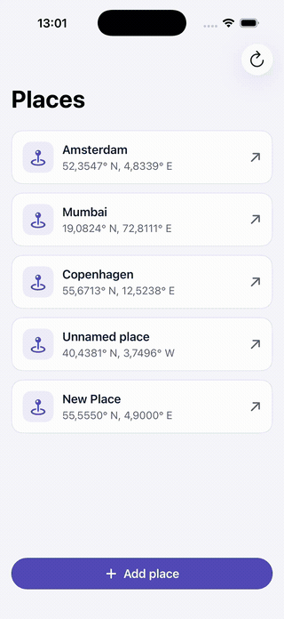
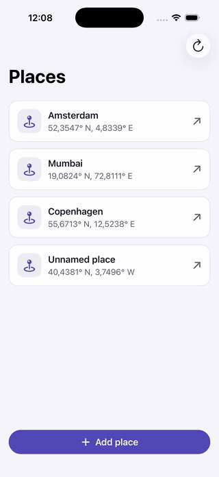
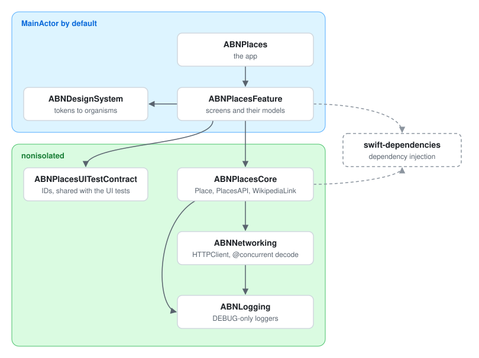
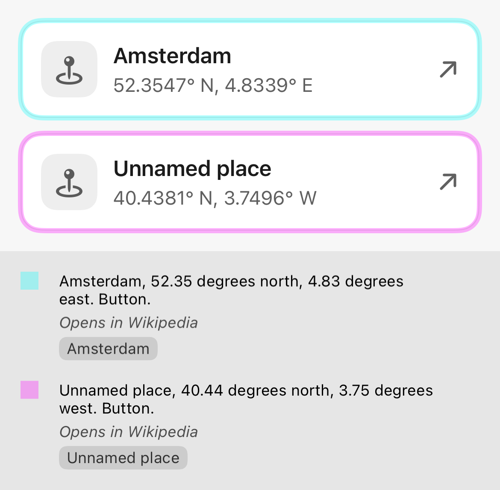
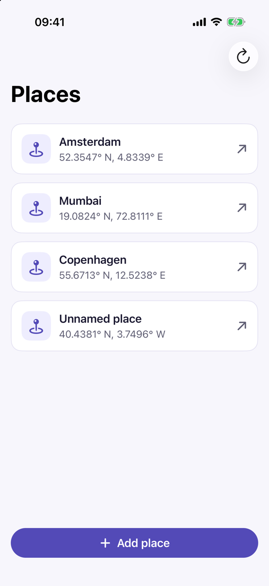
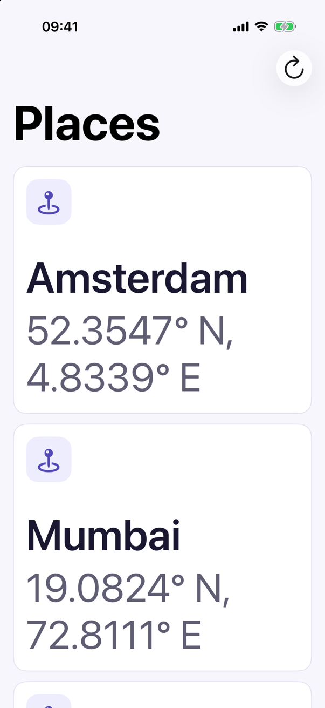
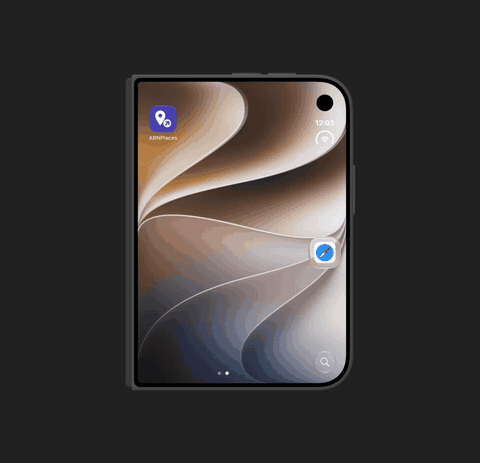

# ABN assignment: Wikipedia & places companion app

This repo contains 2 apps:

1. **Wikipedia** (`Wikipedia/`): the Wikipedia iOS app, changed so every launch opens the Places tab, and so another app can open Places centred on a location.
2. **ABNPlaces** (`ABNPlaces/`): a SwiftUI app that lists places and opens them in Wikipedia, plus places you add yourself.

<p align="center">
  
  &nbsp;&nbsp;
  
</p>

## Run it

Run both apps on the same simulator. There's nothing to install.

1. Open `Wikipedia/Wikipedia.xcodeproj`, choose the `Wikipedia` scheme and an iPhone simulator, and press Run. **ABNPlaces needs this repo's Wikipedia, not the official app.** The official Wikipedia opens from the link too, but ignores the location, and ABNPlaces can't tell the difference. This build keeps the official bundle id, so it replaces any other Wikipedia on that simulator.
2. Finish Wikipedia's onboarding once.
3. Open `ABNPlaces/ABNPlaces.xcodeproj`, choose the `ABNPlaces` scheme and the same simulator, and press Run. The first build asks you to Trust & Enable the swift-dependencies macros.
4. Tap a place. The first time, iOS asks whether to open Wikipedia.

On a device, run `Wikipedia/scripts/setup_bundle_id` first and answer y: `Wikipedia/Configurations/OpenSourceDebug.xcconfig` holds Wikimedia's team id, and the script switches it to your own team and adds your team id to the bundle id. Don't commit the file it changes. Delete the App Store Wikipedia, because iOS may send the link to it. Set your own team on ABNPlaces too.

For development, `make -C ABNPlaces setup` checks Xcode, the snapshot simulator, SwiftLint and swift-format, installs SwiftLint with Homebrew if it's missing, and resolves the packages. You don't need it to build and run.

## The link

ABNPlaces opens Wikipedia with:

```
wikipedia://places?lat=<latitude>&lon=<longitude>[&name=<name>]
```

- `lat` and `lon` are decimal degrees with a `.`, such as `52.3547498`: latitude from −90 to 90, longitude from −180 to 180, at most 15 decimals, no exponent or `+`.
- `name` is optional. Wikipedia removes control and format characters (such as zero-width spaces), normalises and trims the text, cuts it to 100 characters and shows it on the pin.
- An invalid link opens Places as usual. A link with `WMFArticleURL` keeps its old meaning and ignores the location.
- ABNPlaces always writes the numbers with a `.` and at most 7 decimals, also on a Dutch device that shows `52,3547` on screen.
- Both apps test the same example links: `WikipediaLinkTests` in ABNPlaces and `PlacesLocationRequestTests` in Wikipedia.

All the rules: [Wikipedia/docs/url_schemes.md](Wikipedia/docs/url_schemes.md).

## How our Wikipedia differs from upstream

`Wikipedia/` is [wikimedia/wikipedia-ios](https://github.com/wikimedia/wikipedia-ios) as of 8 October 2026 (upstream's tag `alphas/1893`, commit `d2b887f`), imported with `git subtree --squash`. Our changes:

- Every launch opens the Places tab, also with "Open app on Search tab" on; a link, shortcut or notification can then pick another tab. The last article isn't reopened on top of it.
- `wikipedia://places?lat=&lon=&name=` centres the map on that point and puts a pin on it (`PlacesLocationRequest` in the WMF framework, `PlacesViewController.showLocation`).
- The build only lints. Upstream's build phases ran `swiftlint --fix`, which rewrites files during a build.
- `Configurations/OpenSourceDebug.xcconfig` is committed, so Wikipedia builds without a setup script.
- The UI tests' robot opens the Home tab itself, and `testLaunchOpensPlaces` checks the launch tab.

## ABNPlaces architecture



The app target only shows the root view of the local `ABNPlacesKit` package, which has six modules. `ABNDesignSystem` knows nothing about places. `ABNPlacesUITestContract` holds the accessibility identifiers and launch arguments, and the UI tests use it too.

**Concurrency.** Swift 6 language mode, with `NonisolatedNonsendingByDefault`, `InferIsolatedConformances` and `MemberImportVisibility`, and warnings as errors. The UI modules run on the main actor by default; Core, Networking, Logging and the test contract are nonisolated. The JSON decode is the only `@concurrent` function, so it never runs on the main actor. There's no `@unchecked Sendable`, `nonisolated(unsafe)` or `@preconcurrency`.

**Dependencies.** swift-dependencies injects:

- `PlacesAPI`, a `@DependencyClient` that loads the feed with an ephemeral session and no cache. In tests it's unimplemented, so a test that forgets to set it fails.
- `PlacesLocalStorage`: the places you add, in memory and shared by all windows.
- `openURL`, to open Wikipedia.

**Data flow.** `PlacesListModel` loads the feed and shows it, followed by the places you added. A tap goes to `WikipediaOpener`, which builds the link with `WikipediaLink` and calls `openURL`; two quick taps open Wikipedia once. When `openURL` returns false, the app shows "Couldn't open Wikipedia", because iOS gives the same answer when Wikipedia isn't installed and when you cancel its prompt. `CreatePlaceModel` reads coordinates typed with a `.` or a `,`, saves the place, and the list updates.

## Accessibility



*An accessibility snapshot from the tests. Each colour is one VoiceOver element. The text is what VoiceOver reads, the italic line is the hint, and the grey label is the name Voice Control responds to.*

- **VoiceOver:** labels on the controls, hints on the cards and fields, headings on the state titles, and coordinates read as words: "52.35 degrees north, 4.83 degrees east" (in Dutch, "graden noord").
- **Dynamic Type** up to the largest accessibility size. The grid's columns follow the width and the text size. "Add place" is pinned at the bottom with capped text, and moves into the list at the accessibility sizes.
- **Contrast:** every colour has an Increase Contrast value. Unit tests check that each colour pair meets its WCAG 2.2 contrast minimum, in light and dark, with and without Increase Contrast, and that Increase Contrast never lowers a pair's contrast.
- **Voice Control:** cards have input labels, so "Tap Amsterdam" works. The fields set them too, but iOS 26.5 ignores them on a text field.
- **Focus:** Save moves focus to the first invalid field.
- **Keyboard:** ⌘R refreshes, ⌘N adds a place, ⌘Return saves and Esc cancels.
- **Languages:** English and Dutch.

<p align="center">
  
  &nbsp;&nbsp;
  
  <br>
  <em>The default text size, and the largest accessibility size.</em>
</p>

<p align="center">
  
  <br>
  <em>The grid follows the width: iPhone Duo, folded and unfolded.</em>
</p>

How it's checked:

| Layer | Checks | Command |
|---|---|---|
| Unit tests | Contrast ratios, row layout, coordinate text and speech | `make test` |
| Snapshots | Components in light, dark, the largest text size and Increase Contrast; every screen state, and the loaded list also in dark, at the largest text size, in Dutch and on iPad; accessibility snapshots like the one above | `make test-snapshots` |
| UI tests | `performAccessibilityAudit()` on the list (loaded and failed) and on the sheet with errors, on iPhone and iPad | `make test-ui` |
| By hand | VoiceOver and Voice Control on a device, all 12 text sizes, dark mode with Increase Contrast, Dutch, iPad rotation and window sizes | |

## Testing

Run these from `ABNPlaces/`:

| Command | Runs |
|---|---|
| `make check` | SwiftLint and swift-format, the `Unit` and `Snapshots` test plans, the app build, and a compile of the UI tests |
| `make test` | the `Unit` test plan: every `ABNPlacesKit` test target |
| `make test-snapshots` | the `Snapshots` test plan |
| `make snapshots-record` | records every snapshot again |
| `make test-ui` | the `UI` test plan, with the accessibility audits. On iPad: `make test-ui DESTINATION='platform=iOS Simulator,name=iPad Pro 13-inch (M5)'` |
| `make lint` | SwiftLint and swift-format's lint, both strict |
| `make format` | swift-format, which rewrites the sources |
| `make build` | the app |

- `make check` is the check before every commit; there's no CI. The test plans are in `ABNPlaces/TestPlans/`.
- Snapshots are recorded on an iPhone 17 simulator with iOS 26.5, and only match there; on another simulator, the tests say which one to use. After `make snapshots-record` (which always ends in TEST FAILED), review the changed images like code. In Xcode, ⌘U with the `Snapshots` plan only records missing ones.
- The snapshot tests run in a small host app, `ABNPlacesTestHost`, so UIKit's accessibility is loaded for the accessibility snapshots.
- Snapshots don't draw Liquid Glass, so the bars in the images look white on white. The app itself is fine.
- The UI tests use screen objects and the identifiers from `ABNPlacesUITestContract`. In DEBUG builds, `-PlacesScenario success|empty|offline|slow|recovers|updates` replaces the feed with a canned one, which is handy for demos too.

Wikipedia's tests for the link:

```bash
xcodebuild test -project Wikipedia/Wikipedia.xcodeproj -scheme Wikipedia \
  -destination 'platform=iOS Simulator,name=iPhone 17,OS=26.5' -parallel-testing-enabled NO \
  -only-testing:WikipediaUnitTests/PlacesLocationRequestTests \
  -only-testing:WikipediaUnitTests/PlacesLinkRoutingTests \
  -only-testing:WikipediaUnitTests/NSUserActivity_WMFExtensions_wmf_activityForWikipediaScheme_Test \
  -only-testing:WikipediaUnitTests/URLParsingAndRoutingTests
```

The launch tab is checked by `HomeUITests/testLaunchOpensPlaces`, in the `WikipediaUITests` scheme with the `UITests` test plan.

## Deliberately not built

- Persistence: places you add are gone after a relaunch.
- Images for the places in the list.
- Search: there's no search by name and no map picker; you type the coordinates.
- Separate interface and implementation modules, coordinators, a generic request layer, and CI.

## Requirements

- Developed and tested with Xcode 27.0 (Swift 6.4). ABNPlaces' project file is saved in the Xcode 16 format (`objectVersion 77`) instead of Xcode 27's default, so Xcode 26 should open and build it, but that's untested.
- ABNPlaces runs on iOS 18.0 or later; Wikipedia on upstream's iOS 17.6.
- `make test-snapshots`, `make snapshots-record` and `make check` need the iOS 26.5 runtime and a simulator named exactly "iPhone 17". `make test`, `make test-ui` and `make build` use a simulator named "iPhone 17" on any iOS.
- `make lint` needs SwiftLint (`brew install swiftlint`). The version is pinned to 0.65.1 in `ABNPlaces/.swiftlint-version`, and `make setup` warns about another one. swift-format comes with Xcode.
